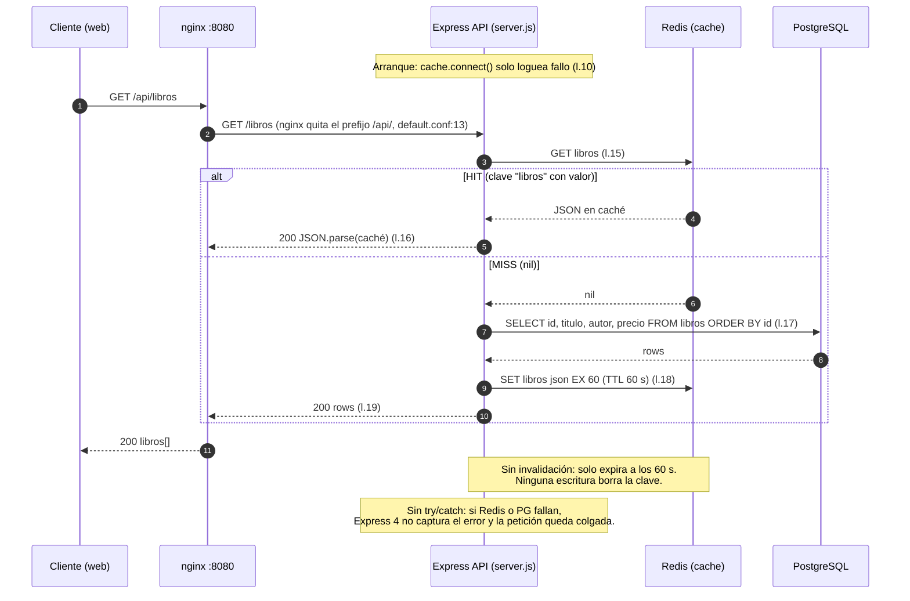
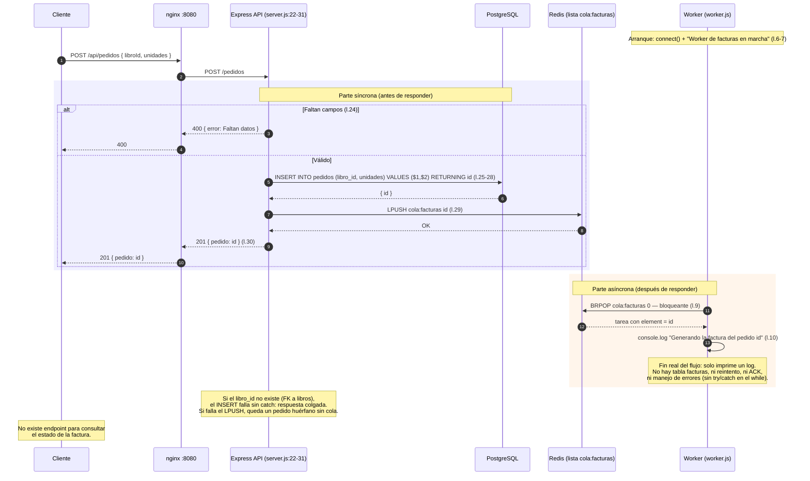

# Diagramas de Flujo

Diagramas generados a partir del código real (`api/src/server.js`, `worker/worker.js`,
`nginx/default.conf`, `db/init.sql`, `docker-compose.yml`).

## GET /api/libros (caché Redis)

## POST /api/pedidos (cola de facturas + worker)

## Notas de implementación

- La cola no usa Bull/RabbitMQ: es una lista Redis cruda (`LPUSH` en `server.js:29`, `BRPOP` en `worker.js:9`).
- El worker solo tiene `REDIS_URL` (`docker-compose.yml:36`), no acceso a la base de datos.
- Redis persiste con `--save 60 1` y volumen (`docker-compose.yml:65-67`): claves de caché y entradas de cola sobreviven a un reinicio.
- Las rutas Express son `/libros` y `/pedidos`; el prefijo `/api/` lo elimina nginx.

---

*Última actualización: 16/10/2026*
